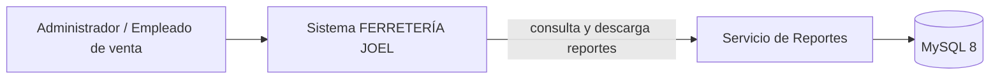
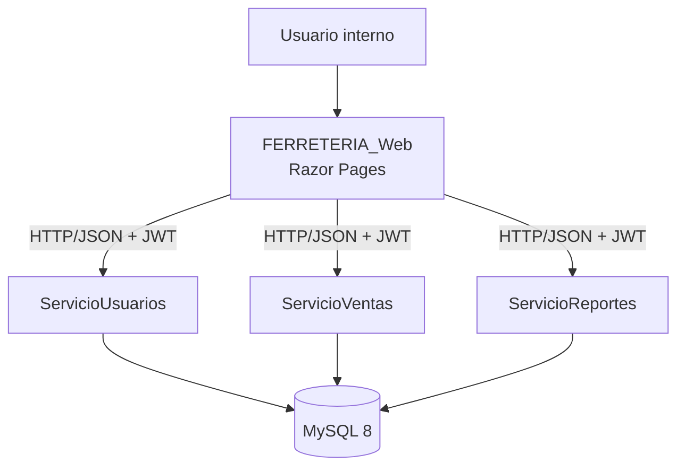
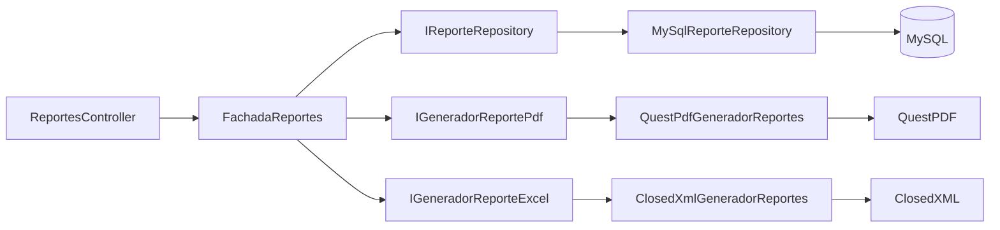
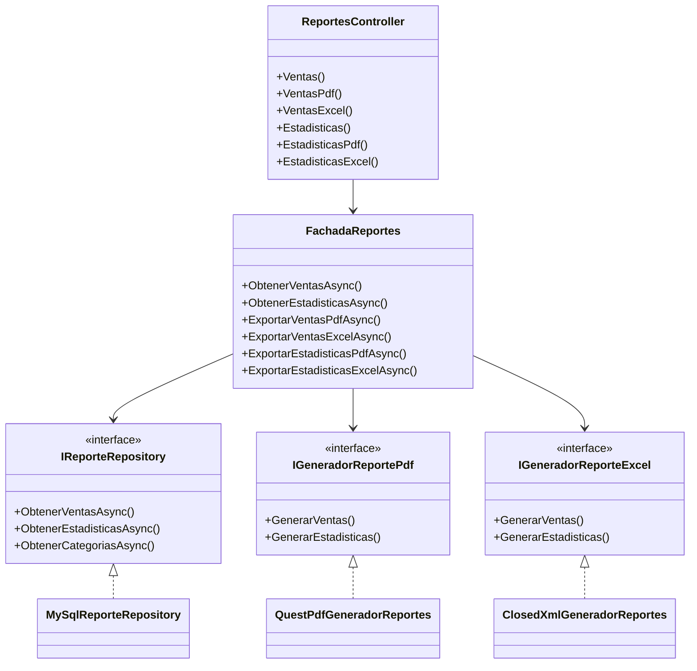

# Reporte del Entregable 3 — Servicio de Reportes

**Proyecto:** FERRETERÍA JOEL — Sistema administrativo
**Módulo entregado:** Servicio de Reportes (reporte detallado y reporte estadístico con exportación PDF/Excel)
**Arquitectura:** Hexagonal (Dominio · Aplicación · Infraestructura) + UI Razor Pages
**Servicio backend:** `ServicioReportes` (ASP.NET Core Web API, .NET 10)
**Cliente web:** `FERRETERIA_Web` (Razor Pages)
**Base de datos:** MySQL 8 (`bdferreteria`)
**Fecha:** 2026

---

## 1. Resumen ejecutivo

Se implementó el **Servicio 3 — Reportes** como un microservicio independiente que
consulta MySQL con ADO.NET puro y entrega información en tres canales:

1. **JSON** para las pantallas Razor.
2. **PDF** con QuestPDF.
3. **Excel `.xlsx`** con ClosedXML.

La entrega cubre los dos informes obligatorios:

| Informe | Ruta web | Contenido | Exportación |
|---|---|---|---|
| Detallado de ventas | `/Reportes/Ventas` | Listado numerado de líneas de venta con cliente, vendedor, categoría, producto, cantidades, precios y estado | PDF (A4 horizontal) y Excel |
| Estadístico de ventas | `/Reportes/Estadisticas` | Agregado por categoría con `GROUP BY`, ventas distintas, unidades, importe, precio promedio y participación | PDF (A4 vertical) y Excel con gráfico |

Ambos formatos incluyen **membrete institucional, logotipo, colores corporativos,
paginación, fecha y hora de emisión, usuario responsable abreviado y totales al
pie**. El informe estadístico incorpora **gráfico de barras** en la vista web
(Chart.js) y en los archivos PDF y Excel.

Resultado verificado: **build completo sin errores ni advertencias**, contenedores
`ferreteria-reportes` y `ferreteria-web` saludables, API validada con JWT de
administrador y de empleado, y descargas PDF/Excel comprobadas por tipo MIME,
nombre de archivo y contenido interno.

---

## 2. Alcance

### 2.1 Incluido en este entregable

- Caso de uso de reporte detallado de ventas.
- Caso de uso de reporte estadístico agrupado por categoría.
- Filtros por rango de fechas, categoría y estado de venta.
- Cálculo de totales, promedios y participación porcentual.
- Exportación a PDF y Excel con identidad visual institucional.
- API REST protegida por JWT con roles `Administrador` y `EmpleadoVenta`.
- Pantallas Razor con filtros, tablas, tarjetas de totales y gráfico interactivo.
- Puerto, adaptadores, fachada y repositorio propios del servicio.

### 2.2 Fuera de alcance

- Registro, anulación y comprobantes de venta (pertenecen a `ServicioVentas`).
- Login, emisión de JWT y administración de usuarios (pertenecen a `ServicioUsuarios`).
- CRUD de productos, categorías, clientes y empleados (catálogos de otros módulos).
- Envío de reportes por correo o almacenamiento histórico de emisiones.

---

## 3. Arquitectura

La solución es de **microservicios**; dentro de `ServicioReportes` se aplica la
separación hexagonal por capas:

```
ServicioReportes/
├── Dominio/
│   ├── Constantes/       EstadoVenta, RolesSistema
│   └── Utilidades/       NombreAbreviado
├── Aplicacion/
│   ├── Modelos/Reportes/ Solicitudes, filtros, líneas y reportes
│   ├── Excepciones/      ReporteValidacionException
│   ├── Puertos/          IReporteRepository, IGeneradorReportePdf, IGeneradorReporteExcel
│   └── Servicios/        FachadaReportes
├── Infraestructura/
│   ├── Conexion/         IDbConnectionFactory, MySqlConnectionFactory
│   ├── Repositorios/     MySqlReporteRepository (ADO.NET puro)
│   └── Documentos/       QuestPDF, ClosedXML, paleta, logo y gráfico
└── Controllers/          ReportesController
```

Reglas de dependencia respetadas:

- **Dominio** no depende de ASP.NET, MySQL, QuestPDF ni ClosedXML.
- **Aplicación** define los puertos y orquesta el caso de uso; no contiene SQL ni
  código de generación de documentos.
- **Infraestructura** implementa los puertos con MySQL, QuestPDF y ClosedXML.
- **Controlador** solo valida, traduce errores a HTTP y devuelve `FileResult`.
- **Razor Pages** solo consumen `ReportesApiCliente`; nunca abren conexiones ni
  escriben SQL.

La UI vive en el microservicio web y se comunica con `ServicioReportes` por HTTP
usando el JWT guardado en la sesión del usuario.

### 3.1 Patrones de diseño aplicados

| Patrón | Implementación | Beneficio |
|---|---|---|
| **Facade** | `FachadaReportes` | Una sola puerta de entrada para consultas y exportaciones; el controlador no conoce repositorios ni generadores |
| **Repository** | `IReporteRepository` / `MySqlReporteRepository` | Aísla el acceso a MySQL y concentra todo el SQL parametrizado |
| **Ports & Adapters (Hexagonal)** | `IGeneradorReportePdf`, `IGeneradorReporteExcel`, `IDbConnectionFactory` | La aplicación depende de contratos; QuestPDF, ClosedXML y MySQL son adaptadores reemplazables |
| **Dependency Injection** | `Program.cs` | Resuelve fachada, repositorio, fábrica de conexión y generadores por constructor |
| **Strategy** | `IGeneradorReportePdf` / `IGeneradorReporteExcel` | Permite cambiar la tecnología de PDF o Excel sin modificar el caso de uso |
| **DTO / Records inmutables** | `ReporteVentas`, `ReporteEstadisticas`, filtros y líneas | Transportan datos tipados y de solo lectura entre capas |

### 3.2 Principios SOLID

- **SRP:** el controlador solo traduce HTTP; el repositorio solo consulta MySQL;
  cada generador solo produce su formato; la fachada solo orquesta.
- **OCP:** un nuevo formato de salida se agrega implementando un puerto, sin
  tocar `FachadaReportes` ni las páginas.
- **LSP:** `QuestPdfGeneradorReportes` y `ClosedXmlGeneradorReportes` respetan
  exactamente los contratos de sus puertos.
- **ISP:** los puertos son pequeños y específicos (`IReporteRepository`,
  `IGeneradorReportePdf`, `IGeneradorReporteExcel`) en lugar de una interfaz
  monolítica.
- **DIP:** la capa de aplicación depende de abstracciones; la infraestructura
  implementa esas abstracciones y se inyecta desde `Program.cs`.

---

## 4. Reporte 1 — Detallado de ventas

### 4.1 Objetivo

Presentar el **listado cronológico de productos vendidos** en un período, con
trazabilidad de la venta, el cliente, el vendedor y el producto.

### 4.2 Tablas utilizadas

La consulta usa **seis tablas**:

- `venta`
- `detalle_venta`
- `producto`
- `categoria`
- `cliente`
- `empleado`

### 4.3 Columnas mostradas

| Columna | Origen |
|---|---|
| N.º | Numeración correlativa calculada en presentación |
| Fecha | `venta.FechaRegistro` |
| Comprobante | `venta.CodigoVenta` y método de pago |
| Cliente | `cliente.Nombre` + `cliente.Apellido` |
| Vendedor | `empleado.Nombre` + `empleado.Apellido` |
| Categoría | `categoria.Nombre` |
| Producto | `producto.Nombre` + `producto.Codigo` |
| Cantidad | `detalle_venta.Cantidad` |
| Precio unitario | `detalle_venta.PrecioUnitario` |
| Importe | `detalle_venta.TotalProducto` |
| Estado | `venta.EstadoVenta` |

### 4.4 Filtros

| Filtro | Comportamiento |
|---|---|
| `Desde` | Fecha inicial inclusiva. Por defecto, 30 días antes de `Hasta`. |
| `Hasta` | Fecha final inclusiva. En SQL se usa `Hasta + 1 día` como límite exclusivo. |
| `IdCategoria` | Opcional. Filtra por categoría activa. |
| `EstadoVenta` | `Registrada`, `Anulada` o `Todas`. En la UI el valor inicial es `Registrada`. |

Validaciones:

- `Desde` no puede ser posterior a `Hasta` → HTTP 400.
- Una categoría inexistente o inactiva → HTTP 400.
- Un estado distinto de los permitidos → HTTP 400.

### 4.5 Totales del reporte

Se calculan en memoria a partir de las filas obtenidas:

- **Ventas**: comprobantes distintos (`IdVenta` únicos).
- **Registros**: cantidad de líneas de detalle.
- **Unidades**: suma de `Cantidad`.
- **Importe total**: suma de `TotalProducto`.
- **Promedio por registro**: importe total / registros.

Los totales se muestran en la vista web, en el pie del PDF y en la fila
`TOTAL GENERAL` del Excel.

### 4.6 SQL canónico

```sql
SELECT
    v.IdVenta,
    v.CodigoVenta,
    v.FechaRegistro,
    CONCAT(c.Nombre, ' ', c.Apellido) AS Cliente,
    cat.Nombre AS Categoria,
    p.Codigo AS CodigoProducto,
    p.Nombre AS Producto,
    dv.Cantidad,
    dv.PrecioUnitario,
    dv.TotalProducto,
    v.EstadoVenta,
    v.MetodoPago,
    CONCAT(e.Nombre, ' ', e.Apellido) AS Vendedor
FROM venta v
INNER JOIN detalle_venta dv ON dv.IdVenta = v.IdVenta
INNER JOIN producto p ON p.IdProducto = dv.IdProducto
INNER JOIN categoria cat ON cat.IdCategoria = p.IdCategoria
INNER JOIN cliente c ON c.IdCliente = v.IdCliente
INNER JOIN empleado e ON e.IdEmpleado = v.IdEmpleadoResponsable
WHERE v.FechaRegistro >= @desde
  AND v.FechaRegistro < @hastaExclusivo
  -- Opcionales, agregados solo si el filtro llega informado:
  AND cat.IdCategoria = @idCategoria
  AND v.EstadoVenta = @estadoVenta
ORDER BY v.FechaRegistro DESC, v.IdVenta DESC, dv.IdDetalleVenta;
```

Todos los valores variables se envían como `MySqlParameter`; no hay
concatenación de datos del usuario en el SQL.

---

## 5. Reporte 2 — Estadístico de ventas

### 5.1 Objetivo

Resumir la actividad económica **por categoría**, mostrando cuántas ventas y
unidades aporta cada una, su importe, su precio promedio y su participación sobre
el total del período.

### 5.2 Agregación

La consulta usa `GROUP BY` sobre `categoria` y combina `venta`, `detalle_venta`,
`producto` y `categoria`:

- `COUNT(DISTINCT v.IdVenta)` → cantidad de ventas distintas.
- `SUM(dv.Cantidad)` → unidades vendidas.
- `SUM(dv.TotalProducto)` → importe total.
- `SUM(dv.TotalProducto) / SUM(dv.Cantidad)` → precio promedio ponderado.
- Participación → calculada en la capa de aplicación como
  `importe categoría × 100 / importe total`.

### 5.3 SQL canónico

```sql
SELECT
    cat.IdCategoria,
    cat.Nombre AS Categoria,
    COUNT(DISTINCT v.IdVenta) AS CantidadVentas,
    COALESCE(SUM(dv.Cantidad), 0) AS UnidadesVendidas,
    COALESCE(SUM(dv.TotalProducto), 0) AS TotalImporte,
    COALESCE(
        SUM(dv.TotalProducto) / NULLIF(SUM(dv.Cantidad), 0),
        0
    ) AS PrecioPromedio
FROM venta v
INNER JOIN detalle_venta dv ON dv.IdVenta = v.IdVenta
INNER JOIN producto p ON p.IdProducto = dv.IdProducto
INNER JOIN categoria cat ON cat.IdCategoria = p.IdCategoria
WHERE v.FechaRegistro >= @desde
  AND v.FechaRegistro < @hastaExclusivo
  -- Opcionales:
  AND cat.IdCategoria = @idCategoria
  AND v.EstadoVenta = @estadoVenta
GROUP BY cat.IdCategoria, cat.Nombre
ORDER BY TotalImporte DESC, cat.Nombre;
```

### 5.4 Filtros

Comparte los filtros del reporte detallado: rango de fechas, categoría y estado.
La categoría también se valida contra el catálogo activo antes de consultar.

### 5.5 Gráfico

| Canal | Implementación |
|---|---|
| Web | Chart.js 4.4.7 local (`wwwroot/lib/chart.js/chart.umd.min.js`), barras horizontales, tooltip en bolivianos y eje compacto. |
| PDF | `GraficoBarrasReporte` dibuja las barras con primitivas de QuestPDF y las inserta como imagen. |
| Excel | El mismo gráfico se renderiza a PNG con QuestPDF `GenerateImages(...)` y se incrusta con `AddPicture(...).MoveTo(...).WithSize(...)`. |

Se muestran como máximo las **12 categorías con mayor importe**, ordenadas de
mayor a menor, para mantener legibilidad en los tres canales.

Si no hay datos, la vista web oculta el canvas y muestra un mensaje de estado
vacío; el PDF y el Excel muestran la sección sin filas y conservan el membrete y
los totales en cero.

---

## 6. Identidad visual y requisitos de los documentos

### 6.1 Membrete institucional

Definido en `ReportePdfComun.Cabecera` (PDF) y `ComponerMembrete` (Excel):

- Logotipo **FJ** generado en tiempo de ejecución con QuestPDF y reutilizado en
  ambos formatos.
- Nombre **FERRETERÍA JOEL** con la palabra “JOEL” en color corporativo.
- Giro: “Herramientas y materiales de construcción”.
- Dirección, teléfono y correo institucional.
- Título del informe y código:
  - `RPT-VEN-01` para el detallado.
  - `RPT-EST-02` para el estadístico.
- Fecha y hora de emisión.

### 6.2 Colores corporativos

Centralizados en `PaletaReporte`:

- Amarillo institucional para encabezados, totales y barras.
- Amarillo oscuro para acentos y bordes de énfasis.
- Texto principal, secundario y terciario.
- Fondos suaves y bordes para filas alternas y bloques de filtros.

La misma paleta se usa en PDF, Excel, CSS de la vista web y Chart.js.

### 6.3 Paginación

- **PDF:** QuestPDF repite la cabecera de tabla en cada página y el pie muestra
  `Página X de Y`, además de la fecha de emisión, el responsable abreviado y el
  resumen de totales.
- **Excel:** configuración de impresión A4, `PagesWide = 1`, `PagesTall = 0`,
  fila de cabecera repetida en cada página y pie con `Página &P de &N`.

### 6.4 Emisión y responsable

- `GeneradoEl = DateTime.Now` en la fachada, una sola vez por reporte.
- `GeneradoPorCompleto` conserva el nombre completo.
- `GeneradoPor` aplica `NombreAbreviado.De(...)`:
  - “María López” → `M. López`.
  - “J. Ríos” se conserva como nombre de una sola palabra capitalizada.
- La vista web muestra la abreviatura y deja el nombre completo en el atributo
  `title`; el PDF y el Excel muestran la abreviatura en el pie y en el bloque de
  filtros.

### 6.5 Totales al pie

- **PDF:** el pie de cada página incluye `Total general: Bs ... · N registros ·
  N unidades` y la tabla cierra con una fila de totales.
- **Excel:** fila `TOTAL GENERAL` con unidades e importe, con formato monetario y
  estilo destacado.

---

## 7. API REST

Base local: `http://localhost:5073` · Base Docker interna: `http://servicio-reportes:8080`

| Método | Ruta | Descripción | Respuesta |
|---|---|---|---|
| GET | `/api/reportes/categorias` | Categorías activas para los filtros | JSON |
| GET | `/api/reportes/ventas` | Reporte detallado | JSON |
| GET | `/api/reportes/ventas/pdf` | Reporte detallado | `application/pdf` |
| GET | `/api/reportes/ventas/excel` | Reporte detallado | `.xlsx` |
| GET | `/api/reportes/estadisticas` | Reporte estadístico | JSON |
| GET | `/api/reportes/estadisticas/pdf` | Reporte estadístico | `application/pdf` |
| GET | `/api/reportes/estadisticas/excel` | Reporte estadístico | `.xlsx` |
| GET | `/health` | Sonda de salud pública | JSON |

Parámetros comunes:

- `desde` (`yyyy-MM-dd`, opcional; por defecto últimos 30 días).
- `hasta` (`yyyy-MM-dd`, opcional; por defecto hoy).
- `idCategoria` (entero opcional).
- `estadoVenta` (`Registrada`, `Anulada`, `Todas`; opcional).

Seguridad:

- Todos los endpoints de reportes exigen `Authorization: Bearer <JWT>`.
- `[Authorize(Roles = RolesSistema.Personal)]` permite `Administrador` y
  `EmpleadoVenta`.
- Sin token → HTTP 401.
- Filtros inválidos → HTTP 400 con `{ exito: false, mensaje }`.
- Fallo inesperado de base de datos o generación → HTTP 503 con mensaje genérico
  y detalle registrado en el log del servicio.

---

## 8. Capa web (Razor Pages)

### 8.1 Páginas

| Página | Archivo | Responsabilidad |
|---|---|---|
| `/Reportes/Ventas` | `Pages/Reportes/Ventas.cshtml(.cs)` | Filtros, tarjetas de totales, tabla numerada y descargas |
| `/Reportes/Estadisticas` | `Pages/Reportes/Estadisticas.cshtml(.cs)` | Filtros, KPIs, gráfico Chart.js, tabla agregada y descargas |

Ambas heredan de `ReportePageModelBase`, que centraliza:

- Valores predeterminados del rango (últimos 30 días).
- Estado inicial `Registrada`.
- Carga del catálogo de categorías.
- Lectura del JWT desde la sesión (`UsuariosApiCliente.ClaveSesionJwt`).
- Manejo de errores de descarga con `TempData` y redirección conservando filtros.

### 8.2 Descargas

Los enlaces usan handlers GET:

```
/Reportes/Ventas?handler=Pdf&desde=...&hasta=...&idCategoria=...&estadoVenta=...
/Reportes/Ventas?handler=Excel&...
/Reportes/Estadisticas?handler=Pdf&...
/Reportes/Estadisticas?handler=Excel&...
```

El handler llama a `DescargarAsync`, que recibe el `ArchivoDescargaApi` desde
`ReportesApiCliente` y devuelve `File(contenido, tipoContenido, nombreArchivo)`.
El nombre incluye marca de tiempo, por ejemplo
`Reporte-Ventas-20261104-153012.pdf`.

### 8.3 Navegación

`_Layout.cshtml` muestra el grupo **Reportes** para los roles `Administrador` y
`EmpleadoVenta`, con estado activo en ambas páginas.

### 8.4 Comportamiento sin datos

La base de trabajo actual contiene ventas en estado `Anulada`. Por eso:

- Con el filtro predeterminado `Registrada`, ambas pantallas muestran su estado
  vacío (sin filas y sin gráfico).
- Con `Todas`, se visualizan los datos y el gráfico.
- Este comportamiento es correcto: refleja exactamente el filtro elegido.

---

## 9. Paquetes y dependencias

| Paquete | Versión | Uso |
|---|---|---|
| `MySql.Data` | 26.10.0 | ADO.NET puro contra MySQL |
| `QuestPDF` | 2025.4.1 | Generación de PDF y renderizado del gráfico a PNG |
| `ClosedXML` | 0.100.3 | Generación de libros `.xlsx` |
| `System.IO.Packaging` | 10.0.0 | Versión corregida exigida transitivamente por ClosedXML |
| `Microsoft.AspNetCore.Authentication.JwtBearer` | 10.0.14 | Validación del JWT |
| `Swashbuckle.AspNetCore` | 6.6.2 | Swagger/OpenAPI |

No se usa Entity Framework ni ningún ORM. El acceso a datos es exclusivamente
`MySqlConnection`, `MySqlCommand`, `MySqlDataReader` y parámetros.

La imagen Docker de `ServicioReportes` incluye `fontconfig`,
`libfontconfig1`, `fonts-dejavu-core` y `fonts-liberation`, necesarias para que
QuestPDF renderice correctamente en Linux.

---

## 10. Configuración y ejecución

### 10.1 Variables relevantes

| Variable | Uso |
|---|---|
| `ConnectionStrings__MySqlConnection` | Cadena MySQL del servicio |
| `Jwt__Key` | Clave compartida para validar el JWT |
| `Jwt__Issuer` / `Jwt__Audience` | Emisor y audiencia del token |
| `Servicios__ReportesApiUrl` | URL interna que usa la web para llamar al servicio |

En local, `ServicioReportes` lee también el archivo `.env` de la raíz si existe.
El archivo `.env` no se versiona.

### 10.2 Docker Compose

```bash
docker compose up -d --build servicio-reportes ferreteria-web
```

| Contenedor | Puerto host | Descripción |
|---|---|---|
| `ferreteria-mysql` | `3307`* | MySQL 8 |
| `ferreteria-reportes` | `5073` | API de reportes (`:8080` interno) |
| `ferreteria-web` | `5267` | UI Razor Pages (`:8080` interno) |

La web depende de que `servicio-reportes` esté saludable y recibe
`Servicios__ReportesApiUrl=http://servicio-reportes:8080`.

\* El puerto de MySQL es configurable con `MYSQL_PUERTO_HOST`; el valor por
defecto de Compose es `3307` y el entorno de desarrollo actual usa `3308`.

### 10.3 Ejecución local sin Docker

```bash
dotnet run --project ServicioReportes
dotnet run --project FERRETERIA_Web
```

Ajustar `Servicios:ReportesApiUrl` en `FERRETERIA_Web/appsettings.json` si el
puerto cambia.

---

## 11. Verificación realizada

### 11.1 Compilación

```bash
dotnet build FERRETERIA_JOEL.slnx -v q --nologo
```

Resultado: **0 errores, 0 advertencias**.

### 11.2 API

Con JWT de administrador y de empleado se comprobó:

- `GET /api/reportes/categorias` → categorías activas.
- `GET /api/reportes/ventas?estadoVenta=Todas` → 1 venta, 1 línea, 4 unidades,
  importe `Bs 742,00`.
- `GET /api/reportes/estadisticas?estadoVenta=Todas` → 1 categoría con 100 % de
  participación.
- Rango inválido (`desde > hasta`) → HTTP 400.
- Sin token → HTTP 401.
- Login de empleado y abreviatura del responsable → `M. López`.

### 11.3 Archivos

- PDF: `application/pdf`, `Content-Disposition` con nombre correcto, tamaño
  aproximado 90 KB.
- Excel: tipo MIME de `.xlsx`, tamaño aproximado 14–28 KB.
- El Excel estadístico contiene `xl/media/image.png`, `image2.png` y las partes
  de dibujo, lo que confirma el logo y el gráfico incrustados.
- El PDF del reporte detallado usa A4 horizontal; el estadístico, A4 vertical.
- Se verificó texto extraído del PDF: membrete, período, categoría, estado,
  responsable abreviado, filas numeradas, totales, hora de emisión y
  `Página 1 de 1`.

### 11.4 Navegador

- Login correcto con usuario administrador.
- `/Reportes/Estadisticas` carga sin errores de consola.
- Con `Todas`, Chart.js dibuja el canvas y la tabla muestra datos.
- Con `Registrada`, se muestra el estado vacío esperado.
- `/Reportes/Ventas` muestra tabla de 12 columnas, numeración, metadatos y
  totales (`4` unidades, `Bs 742,00`).
- Los enlaces de descarga responden HTTP 200 con el tipo de contenido y el
  nombre de archivo esperados.

---

## 12. Correspondencia con la rúbrica

### 12.1 Rúbrica específica de reportes (20 puntos)

| Punto de la rúbrica | Puntos | Evidencia en la entrega |
|---|---:|---|
| Dos reportes, ambos en PDF y con exportación a Excel | — | `/Reportes/Ventas` y `/Reportes/Estadisticas`; cuatro endpoints de descarga |
| Presentación cuidada: colores apropiados, encabezado con logo y datos sumariados en el pie | — | Membrete con logo FJ, paleta corporativa, totales en pie PDF y fila `TOTAL GENERAL` en Excel |
| Ambos reportes con al menos 2 parámetros de filtración | — | Fechas (`desde`/`hasta`), categoría y estado de venta |
| **Reporte 1:** lista ordenada cuya consulta SQL incluya al menos 2 tablas | **10** | Listado cronológico; SQL con `venta`, `detalle_venta`, `producto`, `categoria`, `cliente` y `empleado` |
| **Reporte 2:** información sumariada con al menos un gráfico estadístico; SQL con al menos 2 tablas | **10** | `GROUP BY` por categoría con `COUNT`/`SUM`; gráfico de barras en web (Chart.js), PDF (QuestPDF) y Excel (PNG incrustado); SQL con 4 tablas |

### 12.2 Cumplimiento técnico complementario

| Requisito | Dónde se cumple |
|---|---|
| Reporte 1: listado detallado ordenado | `/Reportes/Ventas`, `MySqlReporteRepository.ObtenerVentasAsync` |
| Reporte 1: al menos 2 tablas | 6 tablas: `venta`, `detalle_venta`, `producto`, `categoria`, `cliente`, `empleado` |
| Reporte 1: al menos 2 filtros | Fechas, categoría y estado |
| Reporte 1: tabla numerada | Columna `N°` en web, PDF y Excel |
| Reporte 1: totales finales | Tarjetas web, pie PDF y fila `TOTAL GENERAL` en Excel |
| Reporte 2: resumen agregado | `GROUP BY cat.IdCategoria, cat.Nombre` |
| Reporte 2: `SUM` y `COUNT` | `COUNT(DISTINCT v.IdVenta)`, `SUM(dv.Cantidad)`, `SUM(dv.TotalProducto)` |
| Reporte 2: al menos 2 filtros | Fechas, categoría y estado |
| Reporte 2: gráfico en web | Chart.js local en `/Reportes/Estadisticas` |
| Reporte 2: gráfico en PDF | `GraficoBarrasReporte` insertado en QuestPDF |
| Reporte 2: gráfico en Excel | PNG del gráfico incrustado con ClosedXML |
| Exportación PDF | QuestPDF, `FileResult` con `application/pdf` |
| Exportación Excel | ClosedXML, `.xlsx` con tipo MIME correcto |
| Membrete institucional | `ReportePdfComun.Cabecera` y `ComponerMembrete` |
| Logotipo | `LogotipoReporte` (PNG generado y reutilizado) |
| Colores corporativos | `PaletaReporte`, CSS y Chart.js |
| Paginación | `Página X de Y` en PDF y `Página &P de &N` en Excel |
| Fecha y hora de emisión | `GeneradoEl`, cabecera y pie de ambos formatos |
| Responsable abreviado | `NombreAbreviado.De(...)` → `M. López` |
| Totales al pie | Pie PDF y fila de totales Excel |
| Arquitectura hexagonal | `Dominio`, `Aplicacion`, `Infraestructura`, `Controllers` |
| ADO.NET puro, sin ORM | `MySqlReporteRepository` con `MySqlConnection`/`MySqlCommand` |
| SQL fuera de las páginas | Todo el SQL vive en `Infraestructura/Repositorios` |
| SOLID y código limpio | Puertos, fachada, adaptadores, métodos cortos y nombres semánticos |
| Manejo defensivo de errores | Validaciones 400, 401, 503 y registro en `ILogger` |
| Razor Pages con `FileResult` | Handlers `OnGetPdfAsync` / `OnGetExcelAsync` |

---

## 13. Diseño de la solución

### 13.1 C4 — Nivel 1: contexto



### 13.2 C4 — Nivel 2: contenedores



### 13.3 C4 — Nivel 3: componentes de ServicioReportes



### 13.4 Diagrama de clases (resumen)



### 13.5 Flujo de una descarga

1. El usuario aplica filtros en la página Razor.
2. El handler `OnGetPdfAsync` / `OnGetExcelAsync` toma el JWT de la sesión.
3. `ReportesApiCliente` llama al endpoint correspondiente del servicio.
4. `ReportesController` delega en `FachadaReportes`.
5. La fachada consulta el repositorio, calcula totales y participación, y llama
   al generador de PDF o Excel.
6. El servicio responde con bytes, tipo MIME y nombre de archivo.
7. La página devuelve un `FileResult` al navegador.

---

## 14. Limitaciones y trabajo futuro

- El reporte detallado no tiene paginación de servidor: trae las filas del rango
  filtrado. Para volúmenes muy grandes conviene agregar paginación y exportación
  por streaming.
- La participación se calcula en memoria porque depende del total del conjunto;
  si el volumen crece, puede calcularse con una ventana SQL o una segunda
  consulta agregada.
- El logo se genera en tiempo de ejecución para no depender de un archivo
  binario versionado. Si el área de marca entrega un logo oficial, basta con
  reemplazar `LogotipoReporte`.
- El servicio no almacena un histórico de emisiones; cada descarga se genera al
  momento con la fecha y hora actuales.

---

## 15. Conclusión

El Servicio de Reportes queda implementado de extremo a extremo: consulta MySQL
con ADO.NET parametrizado, aplica filtros validados, calcula agregados, expone
una API protegida por JWT y entrega dos informes con identidad institucional en
web, PDF y Excel. La separación por puertos y adaptadores mantiene la lógica de
negocio aislada de la base de datos y de las librerías de documentos, y la
verificación funcional confirma que los requisitos de la rúbrica se cumplen en
los tres canales.

---

## 16. Repositorio y organización del trabajo

- **Repositorio:** <https://github.com/Macacofig/FERRETERIA_JOEL_SERVICIOS>
- **Rama principal:** `master`.
- **Organización:** cada servicio se desarrolla en su carpeta
  (`ServicioUsuarios`, `ServicioVentas`, `ServicioReportes`) y la UI en
  `FERRETERIA_Web`; los cambios se integran mediante ramas de funcionalidad y
  pull requests.
- **Este entregable:** los archivos del Servicio de Reportes se encuentran en
  el árbol de trabajo listos para revisión y commit. No se versiona el archivo
  `.env` con secretos.

Comandos sugeridos para publicar el entregable:

```bash
git switch -c feature/servicio-reportes
git add ServicioReportes FERRETERIA_Web docker-compose.yml README.md
git commit -m "feat(reportes): reportes detallado y estadistico con PDF/Excel"
git push -u origin feature/servicio-reportes
```

---

## 17. Bibliografía y fuentes consultadas

- Microsoft. *ASP.NET Core Razor Pages*. <https://learn.microsoft.com/aspnet/core/razor-pages/>
- Microsoft. *JWT Bearer Authentication*. <https://learn.microsoft.com/aspnet/core/security/authentication/>
- Oracle. *MySQL 8.0 Reference Manual*. <https://dev.mysql.com/doc/refman/8.0/en/>
- QuestPDF. *Documentation*. <https://www.questpdf.com/>
- ClosedXML. *Documentation*. <https://docs.closedxml.io/>
- Chart.js. *Documentation*. <https://www.chartjs.org/docs/latest/>
- Martin, R. C. *Clean Architecture: A Craftsman's Guide to Software Structure and Design*. Prentice Hall, 2017.
- Cockburn, A. *Hexagonal Architecture (Ports and Adapters)*. 2005.
- Fowler, M. *Patterns of Enterprise Application Architecture*. Addison-Wesley, 2002.
